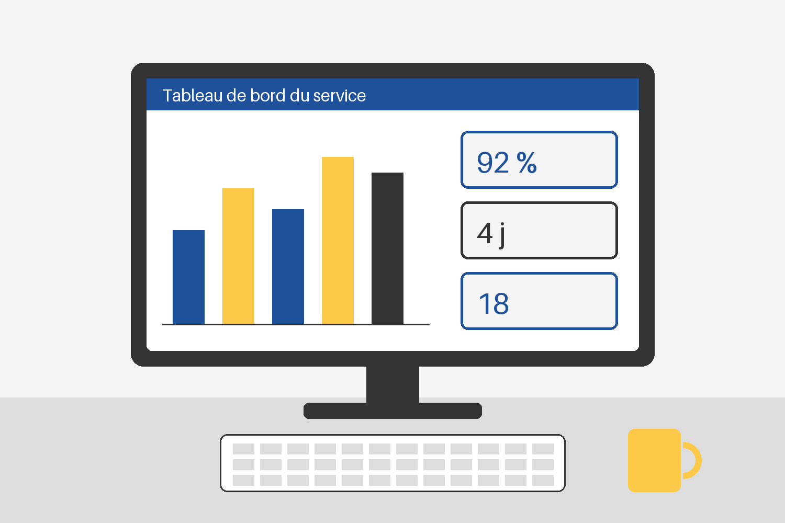

# Piloter un service numérique
Exemple complet du moteur
Organisme Exemple, comité de direction

Notes : Couverture. Le logo client vient de la clé logo_client de l'en-tête.

# Le cadre
Pourquoi piloter, et avec quoi

## Pourquoi piloter le service
Accroche : Un service qu'on ne mesure pas se pilote à l'intuition.
- Savoir ce que le service rend, et à qui
  - demandes traitées, délais, satisfaction
- Repérer tôt ce qui se dégrade
- Décider sur des faits partagés
  - les mêmes chiffres pour tous, à chaque réunion

Notes : Puces à deux niveaux, sous une accroche.
Chaque ligne de notes devient un paragraphe des notes de l'orateur.

## Avant et après le pilotage
### Aujourd'hui
- Des chiffres dans plusieurs fichiers
- Des décisions prises sur impression
- Des retards découverts trop tard
### Demain
- Un tableau de bord unique, mis à jour chaque mois
- Des décisions appuyées sur des indicateurs
- Des alertes avant que le retard s'installe

## Le parcours d'une demande
Schéma : processus
- Dépôt
  - en ligne ou au guichet
- Qualification
  - sous deux jours
- Traitement
  - par l'équipe du service
- Réponse à l'usager
  - par courriel ou courrier
- Clôture
  - avec mesure de satisfaction
Chaque étape a un responsable nommé.

## Les indicateurs suivis
| Indicateur | Ce qu'il mesure | Fréquence | Responsable |
|---|---|---|---|
| Délai de réponse | Jours entre dépôt et réponse | Mensuelle | Cheffe de service |
| Demandes traitées | Volume clos sur la période | Mensuelle | Équipe support |
| Satisfaction | Note donnée par l'usager | Trimestrielle | Chargé de qualité |
| Disponibilité | Part du temps où l'outil répond | Hebdomadaire | Équipe technique |

# S'organiser
Rôles, rythme et règles de décision

## L'organisation du service
Schéma : hiérarchie
- Comité de pilotage
  - Équipe projet
    - cheffe de projet
    - deux référents métier
  - Groupe des utilisateurs
    - six agents volontaires
  - Appui technique
    - service informatique

## Trois leviers d'action
Cartes :
### Former
- Des ateliers courts, par métier
- Un pas à pas par outil
- Un référent par équipe
### Outiller
- Un espace de travail partagé
- Des modèles prêts à l'emploi
- Des réglages communs à tous
### Mesurer
- Cinq indicateurs, pas plus
- Une revue mensuelle courte
- Une alerte au-delà d'un seuil

## Le cycle d'amélioration
Schéma : cycle
- Planifier les actions
- Mettre en œuvre
- Mesurer les effets
- Ajuster la feuille de route
Le cycle reprend à chaque trimestre.

## Les couches du service
Blocs :
### Usages
- Ce que les agents font au quotidien
### Outils
- Les applications et leurs réglages
### Données
- Ce qui est saisi, gardé et partagé
### Gouvernance
- Qui décide, qui arbitre, qui rend compte

## Le calendrier de l'année
Schéma : chronologie
- Janvier : lancement
- Mars : premiers essais
  - avec le groupe des utilisateurs
- Juin : bilan d'étape
- Septembre : généralisation
- Décembre : revue annuelle
Les dates sont indicatives.

## Une demande est-elle recevable ?
Schéma : logigramme
- Réception de la demande
- ? Le dossier est-il complet ?
  - non : Demander les pièces manquantes
- Instruction
- ? L'avis est-il favorable ?
  - non : Notifier un refus motivé
- Notification de l'accord

# Outiller
Règles, paroles et prompts

## Les règles d'usage
Icônes :
- FaShieldAlt : Sécurité : aucune donnée sensible hors des outils validés
- FaUsers : Collectif : les usages se partagent en équipe
- FaBalanceScale : Responsabilité : l'agent reste l'auteur de ce qu'il signe
- FaChartLine : Mesure : chaque usage nouveau a son indicateur

## Une parole de terrain
Citation :
Le tableau de bord n'a rien changé à notre travail,
il a changé nos réunions : on y parle enfin des mêmes choses.
Auteur : Une directrice de service (citation fictive)

## Le prompt du compte rendu
Prompt : À copier tel quel dans l'assistant, puis coller les notes de la réunion.
```
Rôle : tu es secrétaire de séance d'un comité de pilotage.
Tâche : rédige le compte rendu des notes ci-dessous.
Format :
  - décisions prises, une par ligne
  - actions : quoi, qui, pour quand
  - points reportés
Contrainte : n'invente rien ; signale ce qui manque.
```
- Relire avant diffusion : l'assistant peut se tromper

## Ce que fait chaque morceau
Décodage :
- Rôle
  - Cadre le ton et le vocabulaire
  - Essayer un autre rôle, par exemple un juriste
- Tâche
  - Dit ce qu'on attend, en un verbe
  - Préciser le public du compte rendu
- Format
  - Fixe la structure de la réponse
  - Demander un tableau des actions
- Contrainte
  - Limite les inventions
  - Exiger la mention « à vérifier »

## Le poste de travail
Image : gauche
- Un tableau de bord ouvert en permanence
- Trois indicateurs visibles d'un coup d'œil
- Les détails à un clic


## Valeur et effort
Accroche : Commencer par les gains rapides, planifier les projets structurants.
Diapositive libre : exemple-libre.js

Notes : Diapositive dessinée par un module JavaScript voisin de la source.

# Mesurer
Des chiffres fictifs, pour montrer les motifs

## Le service en chiffres
Chiffres clés :
- 1 240 : demandes traitées sur l'année
- 4 j : délai moyen de réponse
- 92 % : usagers satisfaits
Source : données fictives pour l'exemple

## Où en sont les chantiers
Cartes : rouge, orange, vert
### En retard
- Le recrutement du référent
- Une décision attendue du bureau
### À surveiller
- Le budget de formation
- Deux sessions encore à caler
### Acquis
- Le choix de l'outil
- Le groupe des utilisateurs
Pied : Couleurs de signal : rouge en retard, orange à surveiller, vert acquis.
Source : revue de projet fictive pour l'exemple, page 3

## Les demandes par trimestre
Graphique : barres
| Trimestre | 2025 | 2026 |
|---|---|---|
| T1 | 280 | 310 |
| T2 | 300 | 335 |
| T3 | 240 | 290 |
| T4 | 320 | 305 |
Source : données fictives pour l'exemple

## La maturité du service
Radar :
| Dimension | Situation actuelle | Cible à un an |
|---|---|---|
| Gouvernance | 2 | 4 |
| Données | 3 | 4 |
| Compétences | 2 | 3 |
| Outils | 4 | 5 |
| Usages | 1 | 3 |
Source : données fictives pour l'exemple

## Le délai moyen de réponse
Graphique : courbes
| Mois | Délai en jours | Objectif |
|---|---|---|
| Janvier | 7,5 | 5 |
| Février | 6,8 | 5 |
| Mars | 6,1 | 5 |
| Avril | 5,2 | 5 |
| Mai | 4,6 | 5 |
| Juin | 4,1 | 5 |
Source : données fictives pour l'exemple

## L'exposition des métiers
Carte de chaleur :
| Métier | Rédaction | Synthèse | Recherche | Traduction |
|---|---|---|---|---|
| Accueil | 6 | 3 | 4 | 7 |
| Urbanisme | 7 | 8 | 6 | 2 |
| Finances | 4 | 7 | 5 | 1 |
| Ressources humaines | 8 | 6 | 3 | 2 |
Source : données fictives pour l'exemple

## La répartition des demandes
Graphique : secteurs
| Nature | Part |
|---|---|
| Accès et comptes | 38 |
| Matériel | 24 |
| Logiciels métier | 22 |
| Formation | 16 |
Source : données fictives pour l'exemple

# Merci
Clôture : Des questions, des retours ?
Organisme Exemple, service numérique
service-numerique@example.org
